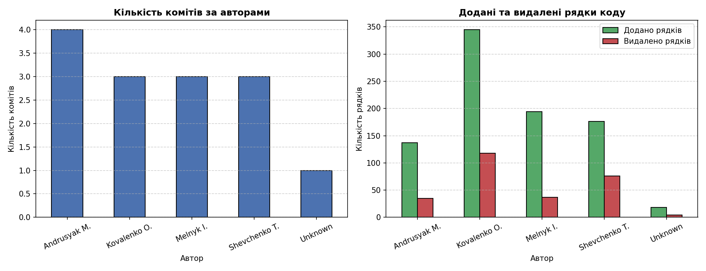

# Аналіз журналу комітів проєкту (Project Commit Log)

Лабораторна робота №11 з дисципліни **«Хмарні технології та штучний інтелект»**.

## Мета роботи
Опанувати роботу з хмарним середовищем обчислень **Google Colab**, бібліотеками аналізу даних (`pandas`, `matplotlib`), вбудованими AI-інструментами та системою контролю версій **GitHub**.

## Структура репозиторію
* `lab_ai_cloud_Andrusyak.ipynb` — Jupyter Notebook із повним кодом генерації, очищення, аналізу та візуалізації даних.
* `commits_clean.csv` — очищений набір даних (14 унікальних комітів без пропусків).
* `author_summary.csv` — зведена статистика активності розробників.
* `commits_charts.png` — візуалізація кількості комітів та обсягу зміненого коду за авторами.

## Основні результати аналізу
* **Найактивніший автор за кількістю комітів:** `Andrusyak M.` (4 коміти).
* **Найбільший обсяг змін у коді:** `Kovalenko O.` (347 доданих та 120 видалених рядків).
* **Найбільший разовий коміт:** `c105` від `Kovalenko O.` (змінено 6 файлів, `+210 / -85` рядків у гілці `main`).

## Візуалізація даних

## Використані технології
* **Мова програмування:** Python 3
* **Бібліотеки:** `pandas`, `matplotlib`
* **Хмарне середовище:** Google Colaboratory
* **AI-інструменти:** Gemini in Colab
* **Контроль версій:** GitHub (Branches, Pull Requests)
